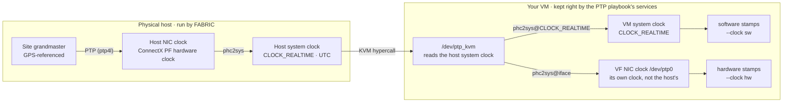

# OWL Clock Chain

*Last updated 2026-11-25.* Which clocks a one-way latency number on a FABRIC VM depends on, who keeps each one right, what the two FABRIC test runs (2026-11-24 and 25) showed about them, and what owl2 does about it.

**Contents**
1. [Why one-way latency needs synchronized clocks](#1-why-one-way-latency-needs-synchronized-clocks)
2. [The six clocks behind one FABRIC timestamp](#2-the-six-clocks-behind-one-fabric-timestamp)
3. [The VF clock](#3-the-part-the-ptp-capable-site-story-leaves-out-the-vf-clock)
4. [Where along the packet's path each timestamp is taken](#4-where-along-the-packets-path-each-timestamp-is-taken)
5. [UTC or TAI](#5-utc-or-tai)
6. [What we measured](#6-what-we-measured)
7. [What can still go wrong, and what catches it](#7-what-can-still-go-wrong-and-what-catches-it)
8. [What owl2 has chosen, and what is still open](#8-what-owl2-has-chosen-and-what-is-still-open)
9. [What this means for data collected with v1](#9-what-this-means-for-data-collected-with-v1)

## 1. Why one-way latency needs synchronized clocks

A ping's round-trip time uses one clock: the sender stamps the departure and the return. A one-way latency uses two, one on each machine:

```
owl(A→B) = t_rx on B's clock − t_tx on A's clock
if B's clock is ahead of A's by δ:  measured = true latency + δ
```

Any offset between the two clocks goes straight into the result, with nothing in the measurement itself to reveal it. A latency of 30 ms with clocks 1 ms apart is simply reported as 31 ms.

Running both directions gives two useful combinations, which the notebook's verdict uses:

```
owl(A→B) + owl(B→A)       = sum of true latencies   (δ cancels → should be just under the RTT)
[owl(A→B) − owl(B→A)] / 2 = δ + (path asymmetry) / 2
```

The sum checks that the *timestamps* are sane. The difference mixes clock offset with route asymmetry, and no measurement can pull those two apart. If it is near zero, both are probably small. If it is large, either the clocks disagree or the two directions take different routes.

> **Consequence:** clock synchronization has to be checked separately, by looking at the clocks themselves. The latency data can expose gross clock errors but can never prove the clocks are right.

## 2. The six clocks behind one FABRIC timestamp

"The VM has PTP" really means a chain of six clocks, each steered from the one before. The first three are on the physical host and FABRIC runs them. The last three are inside your VM and only stay right if the [`fabric-testbed/ptp`](https://github.com/fabric-testbed/ptp) playbook's services are running there.



Both VM clocks are steered from `/dev/ptp_kvm` by two separate `phc2sys` services: `phc2sys@CLOCK_REALTIME` and `phc2sys@<iface>`, one per dataplane interface.

| Clock | Steered by | Used for | If nothing steers it |
|---|---|---|---|
| **Site grandmaster** | GPS (FABRIC) | reference for the site | — |
| **Host NIC clock** (PF PHC on the hypervisor) | `ptp4l` on the host (FABRIC) | the host's PTP | not visible from a VM |
| **Host system clock** | `phc2sys` on the host (FABRIC) | what `ptp_kvm` returns | not visible from a VM |
| **`/dev/ptp_kvm`** | nothing; it only reads | source for both VM services | needs the `ptp_kvm` module (in `linux-modules-extra`) |
| **VM system clock** | `phc2sys@CLOCK_REALTIME` | sw timestamps, `time.time()` | drifts by ppm. CLEM: 0.9 ms off, 6.6 ppm |
| **VF NIC clock** | `phc2sys@<iface>` | hw timestamps | 0.3–0.9 s off, 2–10 ppm |

### `ptp_kvm` is not a hardware clock

It is a paravirtual device. Reading it makes a hypercall that returns the host's system time together with the CPU's timestamp counter at that instant. That lets the VM correct for how long the call itself took, so the result is the host's `CLOCK_REALTIME`, seen from inside the VM to well under a microsecond. Since the host's system clock is UTC, so is `ptp_kvm`. It cannot timestamp packets. It is only the way the host's PTP time gets into the VM.

## 3. The part the "PTP-capable site" story leaves out: the VF clock

When FABRIC marks a site `ptp_capable`, the first three clocks are synchronized. A VM's dataplane NIC is an SR-IOV *virtual function* (VF) of the same ConnectX card as the host's, and it shows up in the VM as its own PTP hardware clock, `/dev/ptp0`. That clock is **not** the host's synchronized clock. It starts from whatever time the VM had when its driver loaded and then runs freely on the card's oscillator, until a service inside the VM steers it.

Evidence from the two runs:

- **Unsteered VF clocks were far off.** Run 1 before the playbook was fixed: 0.3–0.7 s off and drifting 1.7–5.8 ppm. Run 2 at CLEM: 0.88 s off and drifting 10.5 ppm. The host's clock was fine in both cases.
- **The VF accepts adjustments.** `phc2sys@<iface>` pulled it to within 0.65 µs. If the VF clock were the card's shared clock, one tenant's VM could move every other tenant's clock, so it must be the VF's own.
- **One oscillator, separate clocks.** The two VFs in the CLEM VM drifted almost identically (10.5476 and 10.5454 ppm) but were 5.5 µs apart.

> **Likely mechanism (inferred, not confirmed in NVIDIA's docs):** the mlx5 driver reads a free-running counter on the card, and each PCI function (the host's PF and every VF) builds its own adjustable clock on top of it, starting from the system time when the driver loads. A VM's system clock at boot comes from an emulated real-time clock with 1-second resolution, before anything corrects it. That would explain why unsteered VF clocks were off by a fraction of a second rather than by microseconds. This fits every measurement so far.

Consequences:

- `--clock hw` on a FABRIC VM is only valid while `phc2sys@<iface>` runs inside that VM. A synchronized host is not enough.
- The earlier worry that two `phc2sys` services (one for `ptp0`, one for `ptp1`) might fight over one card clock is probably unfounded: they are separate clocks.

## 4. Where along the packet's path each timestamp is taken

The Linux kernel can record several timestamps for the same packet. Software ones use the VM system clock; the hardware one uses the VF's clock.

**Sending (A):**

1. owl calls `sendto()`
2. UDP / IP
3. **Queueing layer (qdisc): SCHED** (`TX_SCHED`, software). Taken by the kernel for every device. owl2 uses this one for `--clock sw`.
4. **Driver: SND** (`TX_SOFTWARE`, software). Only if the driver calls `skb_tx_timestamp()`. The FABRIC mlx5 VFs never produced it.
5. **NIC puts it on the wire: HW** (`TX_HARDWARE`, VF clock). Within nanoseconds of the wire.

**Receiving (B):**

1. **NIC takes it off the wire: HW** (VF clock). Within nanoseconds of the wire.
2. DMA, interrupt delivered through the hypervisor, NAPI poll
3. **Kernel picks it up from the driver: SW RX** (software). After the interrupt and softirq delay, µs to tens of µs in a VM.
4. UDP → socket
5. owl's `recvmsg()`

Which TX timestamps came back on the socket's error queue, on both CLEM and NCSA VMs (IPv4 and IPv6 behaved the same):

| Requested | To the FABNet peer | To loopback |
|---|---|---|
| `TX_SOFTWARE` (SND) | **nothing** | SND |
| `TX_HARDWARE` | SND, hw time | nothing (no NIC) |
| `TX_SCHED` | SCHED | SCHED |

What this means for accuracy, apart from any clock error:

- **`--clock hw`:** both stamps sit within nanoseconds of the wire. Practically all the error is clock error.
- **`--clock sw`:** the TX stamp is taken a few µs *before* the wire (qdisc, driver, DMA), and the RX stamp µs to tens of µs *after* it (interrupt, softirq, with virtualization overhead). sw latencies therefore read high by roughly tens of µs and are noisier. The SND stamp would be a few µs closer to the wire than SCHED, but these drivers don't produce it, and using SCHED everywhere keeps sw results comparable across machines.

## 5. UTC or TAI

PTP's native timescale is TAI, currently 37 s ahead of UTC. A common Linux setup keeps the NIC clock on TAI and converts to UTC only for the system clock. FABRIC VMs don't: `phc2sys -O +0` copies `ptp_kvm`, which is UTC, into the VF clock. So on FABRIC, **hardware timestamps are UTC**.

The danger is mixing the two timescales, which shows up as an error of about 37 s. owl never compares a hardware stamp with a software one, and the reflector returns "no timestamp" rather than a stamp of the other kind. The notebook's clock check recognizes both a UTC and a TAI NIC clock.

## 6. What we measured

| Run | VM clock services | VM system vs `ptp_kvm` | VF clock vs VM system | Result |
|---|---|---|---|---|
| 11-24, first try, UCSD ↔ TOKY | **none**: Ubuntu's `linuxptp` package broke the playbook | — | 0.3–0.7 s, 1.7–5.8 ppm | not usable |
| 11-24, fixed, UCSD ↔ TOKY | all running | 0.40–0.53 µs | 0.42–0.65 µs, < 0.06 ppm | hw: 50/50 every run. IPv6 directions agree to 0.2 µs. IPv4 shows a real 8.2 ms route asymmetry. sw: no TX stamps. |
| 11-25, NCSA side | all running | 0.46 µs | 0.56–0.59 µs | healthy |
| 11-25, CLEM side | **not running** (cause not yet known) | 0.89 ms, 6.6 ppm | 0.88 s, 10.5 ppm | hw: 903.93 ms one way, −858.55 ms the other. Verdict: BROKEN. |

The CLEM run is useful as a deliberate-looking failure:

- The apparent offset from the latencies, (903.93 + 858.55) / 2 = **881.24 ms**, matches the clock check's independent reading of CLEM's VF clock, **881.45 ms**. The latency data and the clock check agree about what went wrong.
- The sum (45.38 ms) still sat just under the RTT (45.66 ms), because the offset cancels. The timestamps themselves were fine. Only the clock was wrong.

> **How precise are the clock-check numbers?** Each offset is measured by reading the system clock, then the other clock, then the system clock again, and keeping the tightest of 300 tries. Reading a NIC clock crosses PCIe and takes around a microsecond, so sub-µs offsets are upper bounds rather than exact values. The strongest end-to-end evidence is run 1's IPv6 result: the two directions over a 62.5 ms path agreed to 0.2 µs.

## 7. What can still go wrong, and what catches it

| Failure | Effect | Caught by the notebook today | Caught by owl2 (planned) |
|---|---|---|---|
| `phc2sys@<iface>` not running | hw off by up to ~1 s, drifting | yes (clock check) | yes (`ptp_ok` guard, Phase 2) |
| `phc2sys@CLOCK_REALTIME` not running | sw off by ms, drifting | partly: also wrongly flags a healthy VF clock, since it compares the VF clock with the system clock | yes, if the guard compares both with `ptp_kvm` (proposal below) |
| `ptp_kvm` module missing (kernel upgraded without `linux-modules-extra`) | neither service can run | yes | yes |
| **The host itself loses PTP** (grandmaster outage, host `ptp4l` unlocked) | `ptp_kvm` is wrong, and every clock in the VM agrees with it | **no** | **no**: needs a check from outside the VM (see below) |
| Route asymmetry | indistinguishable from clock offset in the latency data | not an error, but limits what the apparent offset can prove | — |
| TAI/UTC mix | ≈ 37 s | yes | yes; owl never mixes kinds |

> **The blind spot: the host.** Everything a VM can check is relative to `ptp_kvm`. If the host's own PTP fails, the VM's clocks follow it faithfully, and every check inside the VM still says "synced". Two ways to catch it from outside:
>
> - **Mesh consistency:** with all-to-all probing, one site's bad clock shifts every pair involving that site by the same amount, in opposite directions. The dashboard could flag that pattern.
> - **Coarse NTP check:** owl could compare its clock with public NTP occasionally (a few lines of standard-library Python). That only catches millisecond-scale errors, but those are the ones that ruin the data.

## 8. What owl2 has chosen, and what is still open

- **Decided: `--clock hw` is the default and the FABRIC mode.** It needs `phc2sys@<iface>` running in the VM, and its timebase on FABRIC is UTC.
- **Decided (2026-11-25): `--clock sw` uses `TX_SCHED` on every machine.** It works on every driver, including FABRIC's VFs. Expect sw latencies tens of µs higher and noisier than hw. Use it on hosts without a usable NIC clock.
- **Decided: owl checks clocks but doesn't manage them.** The Phase 2 `ptp_ok` guard marks samples as untrusted instead of dropping them.
- **Proposal: compare both VM clocks with `ptp_kvm`** when it exists, rather than with each other, so a broken system clock isn't reported as a broken NIC clock. The notebook already reads all three, so this is a small change.
- **Decided: the Phase 3 slice manager verifies every VM itself**: services active and offsets small, and it treats a failing site as down. CLEM shows that the `ptp_capable` flag alone isn't enough.
- **Open: host-level PTP failures.** Mesh consistency in the dashboard, a coarse NTP check in owl, both, or neither.

## 9. What this means for data collected with v1

From the `v1-final` code:

- **Sender** (`owl_sender.py`): it finds the device that `phc2sys … -c CLOCK_REALTIME` uses as its source, which is `ptp_kvm`, the host's clock. It reads that device from Python just before `sendto()` and puts the time in the payload. If the lookup fails, it uses `time.time_ns()`, the VM system clock.
- **Receiver** (`owl_capturer.py`): `tcpdump -j adapter_unsynced` records the raw *hardware* RX timestamp, which comes from the receiver's VF clock.

```
v1 latency = VF clock on B − host clock (via ptp_kvm) on A
```

- **The receiver side was only right while `phc2sys@<iface>` ran on the receiving VM.** Without it, values would be off by up to about a second and drift by about 0.4 s per day at 5 ppm. That kind of error is obvious, so periods where v1's dashboard showed plausible latencies most likely had steered VF clocks.
- **The sender side reads high.** The send time is taken in Python before the packet enters the kernel, so v1 includes the Python-to-kernel-to-wire time: tens of µs, with occasional larger spikes from timer scheduling or garbage collection. owl2 removes this by using the kernel's or NIC's own TX timestamp.
